<div align="center">


<br>

<a href="https://gerlynfp.github.io/WEB-CV/"><b>🌐 Ver mi CV web</b></a>
&nbsp;·&nbsp;
<a href="https://www.linkedin.com/in/gerlyn-familia-pilar-81b044215/"><b>💼 LinkedIn</b></a>
&nbsp;·&nbsp;
<a href="mailto:gerlynfp@gmail.com"><b>✉️ gerlynfp@gmail.com</b></a>

</div>

---

## 👋 Sobre mí

Estudio **Ingeniería en Sistemas Computacionales** en UNAPEC y vengo de más de dos años en Teleperformance, donde pasé de atención al cliente bilingüe a **Supervisor de Operaciones**. De ahí me traigo la disciplina de procesos, el ojo para las métricas y la calma para resolver escalamientos. Ahora busco **mi primer rol en tecnología**.

Si tuviera que describirme en código, sería así:

```java
public record Gerlyn(
    String rol,
    String ubicacion,
    List<String> idiomas,
    List<String> stack
) {
    static Gerlyn perfil() {
        return new Gerlyn(
            "Desarrollo, ciberseguridad y soporte TI",
            "Santo Domingo Oeste, RD",
            List.of("Español", "Inglés B2"),
            List.of("Java", "Spring Boot", "HTML", "CSS", "JS")
        );
    }
}
```

## 🧰 Lo que sé hacer



## 🗺️ Mi trayectoria

> Toca cada sección para abrirla.

<details open>
<summary><b>💼 Experiencia</b></summary>
<br>

**Flex Operations Supervisor, Bilingual** · Teleperformance Larimar
<br><sub>📅 Junio 2025 a octubre 2026</sub>

- Verifiqué el cumplimiento de políticas, procesos y estándares, documentando hallazgos y mejoras.
- Monitoreé el desempeño del equipo con métricas, KPIs y reportes.
- Lideré un equipo de agentes bilingües enfocado en objetivos.
- Gestioné escalamientos encontrando la causa raíz.

**Customer Service Expert Agent, Bilingual** · Teleperformance Larimar
<br><sub>📅 Septiembre 2024 a junio 2025</sub>

- Atención y soporte a clientes en español e inglés.
- Resolución de casos por causa raíz, siguiendo los procedimientos establecidos.

</details>

<details>
<summary><b>🎓 Educación</b></summary>
<br>

| Dónde | Qué | Cuándo |
| --- | --- | --- |
| Universidad APEC (UNAPEC) | Ingeniería en Sistemas Computacionales | 2024 a hoy |
| Escuela de Idiomas APEC | Programa de Inglés | 2022 a 2024 |

</details>

<details>
<summary><b>📜 Certificaciones</b></summary>
<br>

- **Cyber Threat Management**: gobernanza, gestión de riesgos, controles, respuesta a incidentes y recuperación ante desastres.
- **Oracle Next Education (ONE)**: Programa Back-end y Formación Principiante en Programación.
- **Formación Java Web**: aplicaciones con Spring Boot.
- Desarrollo de Apps Móviles · HTML desde cero hasta experto.

</details>

## 🤝 ¿Buscas a alguien para…?

<details>
<summary>🛠️ <b>Soporte técnico</b></summary>
<br>

Llevo dos años resolviendo casos reales en dos idiomas: diagnostico, busco la causa raíz, documento y escalo cuando toca. Sé explicar algo técnico sin perder la paciencia.

</details>

<details>
<summary>🛡️ <b>Seguridad de la información o auditoría</b></summary>
<br>

Me formé en gobernanza, riesgos y controles con Cyber Threat Management. Como supervisor verificaba cumplimiento de políticas y documentaba hallazgos, que es buena parte del día a día de una auditoría.

</details>

<details>
<summary>🔍 <b>QA</b></summary>
<br>

Soy de los que revisa el proceso paso a paso y anota qué falló y por qué. Medir, comparar contra el estándar y proponer mejoras era mi trabajo diario.

</details>

<details>
<summary>☕ <b>Desarrollo back-end</b></summary>
<br>

Java y Spring Boot gracias a Oracle Next Education, más HTML, CSS y JavaScript. Este mismo repositorio es una muestra de cómo trabajo.

</details>

## 📂 Sobre este repositorio

Mi CV web, hecho a mano con **HTML, CSS y JavaScript** sin frameworks.

- Diseño responsive con tipografías Bricolage Grotesque e IBM Plex.
- Animaciones suaves: entrada del título, parallax, línea de tiempo que se dibuja al bajar, menú con secciones activas y botón para copiar el email.
- Respeta `prefers-reduced-motion` y funciona bien en el celular.

Para verlo en local solo abre `index.html` en el navegador, o visítalo en **[gerlynfp.github.io/WEB-CV](https://gerlynfp.github.io/WEB-CV/)**.

---

<div align="center">

**¿Hablamos?** Escríbeme a **[gerlynfp@gmail.com](mailto:gerlynfp@gmail.com)** o por **[LinkedIn](https://www.linkedin.com/in/gerlyn-familia-pilar-81b044215/)**.

<sub>Hecho en Santo Domingo 🇩🇴</sub>

</div>
